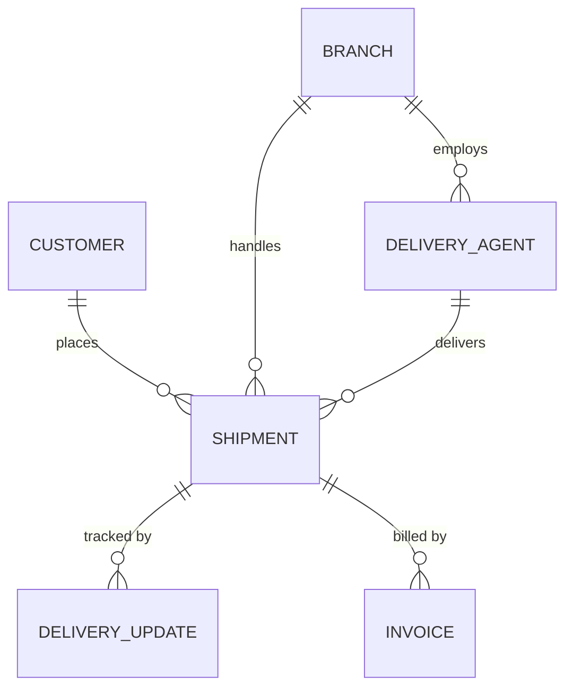
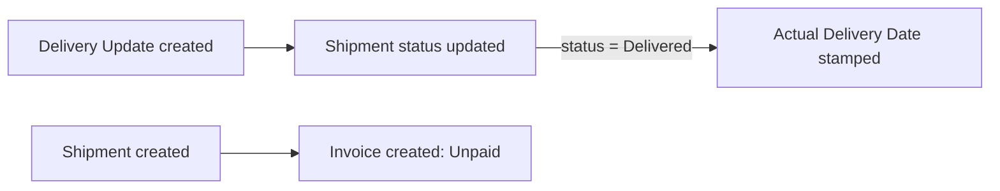

# Courier Management System (CMS) – Salesforce

A Salesforce application that automates courier and logistics operations: customers, branches, shipments, delivery agents, delivery updates and invoices in one platform, with Flow automation, validation rules, role-based security, reports and a dashboard.

**Demo link:** _add your demo link here_  
**Team:** _add team member names here_

## Problem
Courier companies struggle with scattered shipment tracking, delayed delivery updates, poor customer visibility, manual invoicing and no performance analytics. CMS centralizes all of this in Salesforce.

## Data model



| Object | API name | Key fields |
|---|---|---|
| Customer | `Customer__c` | Email, Phone, Address, City, State, Customer Type |
| Branch | `Branch__c` | Branch Code, City, Phone, Manager Name, Active |
| Delivery Agent | `Delivery_Agent__c` | Phone, Email, Vehicle Number, Availability, Branch (lookup) |
| Shipment | `Shipment__c` | Auto-number `SHP-{0000}`, Customer / Branch / Delivery Agent (lookups), Status, Type, Pickup & Delivery Address, Weight, Shipping Cost, Shipment / Expected / Actual Delivery Date, Payment Status |
| Delivery Update | `Delivery_Update__c` | Auto-number `UPD-{0000}`, Shipment (master-detail), Update Status, Location, Remarks, Update Time |
| Invoice | `Invoice__c` | Auto-number `INV-{0000}`, Shipment (master-detail), Amount, Tax, Total (formula), Payment Status, Invoice / Due Date |

Shipment status values: Created → Picked Up → In Transit → Out for Delivery → Delivered (also Delayed, Cancelled, Returned).

## Validation rules
| Object | Rule | Purpose |
|---|---|---|
| Customer | `Email_Required`, `Phone_Min_10_Digits` | Contact data quality |
| Shipment | `Customer_Required`, `Delivery_Address_Required` | Mandatory data |
| Shipment | `Weight_Must_Be_Positive`, `Shipping_Cost_Must_Be_Positive` | Valid numbers |
| Shipment | `Expected_Date_After_Shipment` | Date logic |
| Shipment | `Delivered_Needs_Agent`, `Delivered_Date_Required` | Delivery integrity |
| Delivery Agent | `Agent_Phone_Required` | Valid phone |
| Branch | `Branch_Code_Format` | Code like `CHN001` |
| Delivery Update | `Location_Required`, `Update_Time_Not_Future` | Valid tracking data |

## Automation (record-triggered flows)
1. **Auto Update Shipment Status** – when a Delivery Update is created, its status is copied to the Shipment.
2. **Set Actual Delivery Date** – the first time a Shipment becomes *Delivered*, today's date is stamped.
3. **Create Invoice For Shipment** – every new Shipment gets an *Unpaid* invoice (amount = shipping cost, due in 30 days).



## Security
- **Roles:** Courier Admin → Branch Manager → Delivery Agent / Customer Support
- **Profiles:** Courier Admin (full access), Branch Manager (manage shipments, agents, updates, invoices), Delivery Agent (read shipments, edit only Status & Actual Delivery Date, create Delivery Updates), Customer Support (customers, shipments, invoices; read-only tracking)
- **Permission set:** `CMS User`

## Lightning app, reports and dashboard
- **App:** Courier Management System (Home, Shipments, Customers, Delivery Agents, Branches, Delivery Updates, Invoices, Reports, Dashboards)
- **Reports:** All Shipments, Shipments by Status, Delivered Shipments, Delayed Shipments, Shipment Revenue by Branch
- **Dashboard:** CMS Dashboard – total / delivered / delayed metrics, status donut chart, revenue by branch

## Repository layout
```
force-app/            objects, fields, validation rules, flows, permission set
force-app-ui/         tabs, Lightning app, roles, profiles
force-app-analytics/  report & dashboard folders, reports, dashboard
scripts/apex/         sample data script
manifest/package.xml
```

## Deploy
```bash
sf org login web --alias cms
sf project deploy start --source-dir force-app --target-org cms
sf project deploy start --source-dir force-app-ui --target-org cms
sf project deploy start --source-dir force-app-analytics --target-org cms
sf org assign permset --name CMS_User --target-org cms
```
Then load sample data by pasting `scripts/apex/load_sample_data.apex` into **Developer Console → Debug → Open Execute Anonymous Apex**.

## Manual steps in the org
Users, page-layout tweaks and the custom report type are configured in Setup (see `SUBMISSION_CHECKLIST.md`).

## Test scenario
1. Create a Shipment → status is *Created*, an *Unpaid* invoice appears.
2. Add a Delivery Update with status *In Transit* → the Shipment status changes.
3. Add an update *Delivered* (shipment needs a Delivery Agent) → status is *Delivered* and Actual Delivery Date is filled.
4. Try a shipment with weight 0 or cost 0 → validation blocks it.

## Screenshots
Put screenshots of the app, a shipment record, the flows, reports and dashboard in a `screenshots/` folder.
